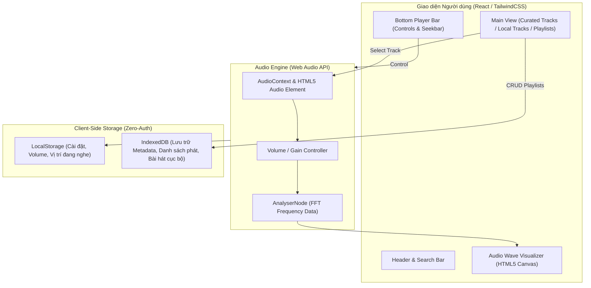

# Product Brief: Zero-Login Music WebApp (Instant-Tune)

> **Status:** GO  
> **Framework:** YC-Style Product Diagnostic (ECC `product-lens` Mode 1)  
> **Workspace:** `webapp-nghe-nhac`  
> **Target Audience:** Listeners seeking immediate, distraction-free music with zero friction.

---

## 1. Executive Summary

Hầu hết các nền tảng streaming âm nhạc hiện nay (Spotify, Apple Music, Zing MP3, Nhaccuatui) đều dựng lên các rào cản lớn: bắt buộc đăng ký tài khoản, gửi OTP, ép liên kết mạng xã hội, chèn quảng cáo thoại gây gián đoạn và hạn chế tính năng nghe nền/chọn bài nếu không trả phí.

**Dự án:** Một ứng dụng web nghe nhạc **"Zero-Login, Instant-Play"** (Vào là nghe ngay trong 3 giây), ưu tiên kiến trúc **Client-First**:
- Không yêu cầu tài khoản hay đăng nhập.
- Cá nhân hóa hoàn toàn cục bộ thông qua trình duyệt (`LocalStorage` + `IndexedDB`).
- Hỗ trợ kho nhạc mẫu tuyển chọn sẵn (Royalty-Free / Lofi / Focus) kèm tính năng kéo thả nhạc từ máy tính (`Local Audio Player`).

---

## 2. The 7 Core Diagnostic Questions (YC Lens)

### 1. Who is this for?
- **Primary Persona:** Lập trình viên, sinh viên, người làm việc văn phòng cần bật nhạc tập trung (Lofi, Ambient, Chillwave, Classical) ngay lập tức khi mở tab làm việc mà không muốn bị gián đoạn hay đăng nhập.
- **Secondary Persona:** Người dùng sở hữu bộ sưu tập file nhạc cá nhân (.mp3, .flac, .wav) trên máy tính muốn một trình phát nhạc trên nền web hiện đại, mượt mà, trực quan, không cần cài phần mềm nặng máy (như iTunes, VLC).
- **Anti-Persona:** Người dùng muốn theo dõi thần tượng K-Pop, hát karaoke chấm điểm, hoặc cần mạng xã hội kết bạn nghe nhạc chung ở giai đoạn này.

### 2. What's the pain?
- **Friction (Rào cản):** Đăng nhập phức tạp, quên mật khẩu, bắt xác minh email chỉ để bật 1 bản nhạc.
- **Interruption (Gián đoạn):** Quảng cáo âm thanh to đột ngột giữa bài tập trung.
- **Privacy (Quyền riêng tư):** Bị theo dõi hành vi nghe nhạc, yêu cầu cấp quyền không cần thiết.
- **Heavy Bloat:** Ứng dụng web/desktop nặng nề, tốn RAM và tải chậm.

### 3. Why now?
- **Web Audio API & Modern Web Standards:** Trình duyệt hiện đại xử lý âm thanh mượt mà, visualizer mượt với Canvas/WebGL, và API giải mã audio tốc độ cao.
- **IndexedDB & File System Access API:** Cho phép lưu trữ và cache danh sách phát, bài hát dung lượng lớn (hàng trăm MB) ngay tại máy người dùng mà không tốn chi phí máy chủ backend.
- **PWA (Progressive Web Apps):** Cho phép cài đặt webapp như một ứng dụng native trên Windows/macOS/di động và nghe offline.

### 4. What's the 10-Star Version?
Nếu không giới hạn về thời gian và ngân sách:
- Tự động nhận diện beat và render visualizer 3D theo thời gian thực (Three.js / WebGL shaders).
- Chia sẻ playlist cho bạn bè qua giao thức P2P WebRTC / URL Hash nén (không cần lưu DB server).
- Tích hợp bộ chỉnh âm Parametric Equalizer chuyên nghiệp 10 dải tần.
- Chế độ Ambient Sound Mixer (kết hợp tiếng mưa, sấm, sóng biển, tiếng quán cà phê hòa cùng nhạc).
- Tách giọng hát / nhạc nền (Vocal Remover / Stem Separation) trực tiếp trên trình duyệt bằng WebAssembly / ONNX Runtime.

### 5. What's the MVP (Minimum Viable Product)?
Sản phẩm nhỏ nhất chứng minh được giá trị cốt lõi:
1. **Curated Showcase:** 10 - 15 bản nhạc Lofi / Focus tuyển chọn bản quyền mở (Creative Commons / Royalty Free) tải nhanh qua CDN.
2. **Local Audio Loader:** Kéo thả (Drag & Drop) hoặc chọn file âm thanh từ máy để phát ngay, tự động đọc ID3 Metadata (Tên bài, nghệ sĩ, ảnh bìa album).
3. **Audio Player Controller:**
   - Play / Pause / Next / Previous.
   - Thanh trượt bài hát (Seek bar) trực quan với hiển thị thời gian (`current` / `duration`).
   - Âm lượng (Volume) + Mute toggle.
   - Chế độ phát ngẫu nhiên (`Shuffle`) và lặp lại (`Repeat All` / `Repeat One`).
4. **Local Playlist Manager:**
   - Danh sách "Bài hát yêu thích" (Favorites).
   - Tự tạo Playlist mới lưu vào `IndexedDB` / `LocalStorage`.
   - Tìm kiếm bài hát theo tên / nghệ sĩ trong thư viện hiện có.
5. **Session Persistence:** Tự động ghi nhớ bài đang phát và vị trí giây cuối cùng trước khi đóng trình duyệt để nghe tiếp khi mở lại.

### 6. Anti-Goals (Tuyệt đối KHÔNG làm trong MVP)
- ❌ **KHÔNG Authentication:** Không username/password, không OAuth (Google, Facebook, GitHub), không JWT token.
- ❌ **KHÔNG Central User Database:** Không xây dựng backend PostgreSQL/MongoDB để lưu hồ sơ người dùng.
- ❌ **KHÔNG Thu thập dữ liệu cá nhân:** Không gắn tracker theo dõi, không xin quyền thông tin cá nhân.
- ❌ **KHÔNG Thanh toán / Gói trả phí:** Không Stripe/Momo/Paypal.
- ❌ **KHÔNG Mạng xã hội:** Không bình luận, không follow, không bảng tin bạn bè.

### 7. How do you know it's working? (Success Metrics)
- **Time-to-Sound (TTS):** < 2.5 giây từ lúc người dùng gõ URL đến khi âm thanh đầu tiên phát ra.
- **Session Duration:** Thời gian nghe trung bình đạt trên 15 phút mỗi phiên.
- **Engagement (Local retention):** Người dùng quay lại nghe nhạc qua Local Storage > 40% sau 7 ngày.
- **Crash/Error Rate:** Tỷ lệ lỗi phát audio (decode error / CORS error) < 0.5%.

---

## 3. Technical Architecture & Constraints

### Technical Stack đề xuất:
- **Frontend Framework:** React + Vite (nhanh, nhẹ, bundle tối ưu).
- **Styling:** Tailwind CSS + Lucide Icons (giao diện hiện đại phong cách Dark Mode tương tự Spotify/Apple Music).
- **Audio Handling:** Web Audio API & HTML5 `<audio>` Element.
- **Local Storage:** `idb-keyval` hoặc `dexie.js` cho IndexedDB + `localStorage` cho UI state.
- **Metadata Parser:** `music-metadata-browser` hoặc `jsmediatags` để trích xuất thẻ ID3 của file cục bộ.

---

## 4. Risk Analysis & Mitigation

| Rủi ro | Mức độ | Biện pháp giảm thiểu (Mitigation) |
| :--- | :---: | :--- |
| **Bản quyền âm thanh** | Cao | Chỉ sử dụng các bài hát có giấy phép Creative Commons / Royalty-Free (từ Free Music Archive, Bensound, Chosic, Pixabay Audio) cho danh mục mặc định. |
| **Dung lượng lưu trữ trình duyệt** | Vừa | `IndexedDB` cho phép lưu trữ 50MB - vài trăm MB tùy trình duyệt. Cung cấp tính năng xóa cache và chỉ lưu file audio cục bộ khi người dùng chủ động import. |
| **CORS policy khi stream** | Vừa | Lưu các file nhạc mặc định ngay trong thư mục `/public/audio` của project hoặc hosting tĩnh (Vercel, Netlify, Cloudflare Pages), không phụ thuộc vào link ngoài kém ổn định. |
| **Treo trình duyệt khi import file lớn** | Thấp | Xử lý import file theo luồng Web Worker / asynchronous chunking, không block Main Thread UI. |

---

## 5. Decision & Next Step

### 🎯 Recommendation: **GO**

Mô hình **Zero-Login Music WebApp** có giá trị rõ ràng, giải quyết đúng sự khó chịu của người dùng hiện đại, có tính khả thi kỹ thuật 100% trên nền tảng Web hiện tại với chi phí vận hành máy chủ gần như 0 đồng (100% client-side + static hosting).

### 🚀 Bước tiếp theo:
1. Thiết kế đặc tả năng lực chi tiết (`product-capability` / Kiến trúc thư mục dự án & UI components).
2. Chuẩn bị tài nguyên âm thanh mẫu (Royalty-Free Audio + Cover images).
3. Triển khai theo quy trình TDD (`tdd-workflow`) từ Audio Engine lõi đến Giao diện Player.
